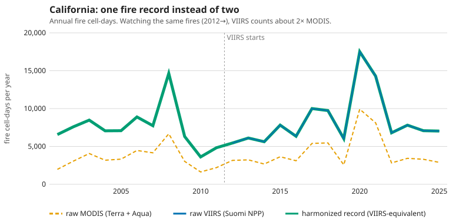
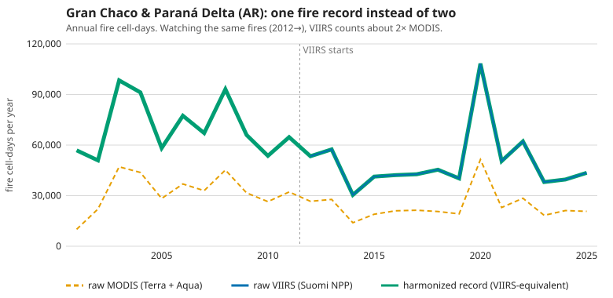
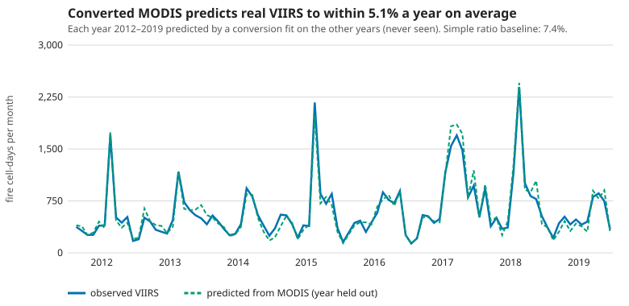

# Plume

**Harmonized Satellite Fire History & Burning-Activity Calendar**

Plume merges 25 years of NASA fire detections from three generations of satellites (MODIS, VIIRS S-NPP and VIIRS NOAA-20) into one consistent record, then turns it into a burning calendar for any area on the map. Emergency managers, land managers and scientists can see when and where an area burns, which months and years were extreme, and how *this* month compares with the same days of every year since 2000. The sensor of origin no longer matters.

**Live:** [plumeos.vercel.app](https://plumeos.vercel.app) · *NASA Space Apps 2026: [Harmonization of MODIS and VIIRS Hot Spots](https://www.spaceappschallenge.org/2026/challenges/modis-and-viirs-hot-spots/)*

---

## Quick Start

```bash
# 1. Setup
git clone https://github.com/1inandy/firex.git && cd firex
python -m venv .venv && source .venv/bin/activate
pip install -r requirements-dev.txt
cp .env.example .env              # optional: FIRMS_MAP_KEY enables the live "this month" view

# 2. Real NASA data (no key needed: FIRMS yearly country files, clipped to each region)
python -m pipeline.fetch --to 2025
python -m pipeline.run data/raw   # clean → grid → harmonize → validate (~1 min, 5.4M hotspots)

# 3. Run the app + API
uvicorn index:app --reload        # http://localhost:8000  (API under /api)
```

### Prerequisites
- **Python** 3.12+
- **NASA FIRMS map key** (optional, free): [get one here](https://firms.modaps.eosdis.nasa.gov/api/map_key/). It is only needed for live near-real-time data.

---

## Overview

Satellites have tracked fire hotspots since 2000, but the record is split. MODIS (Terra 2000→, Aqua 2002→) is drifting and being retired. VIIRS on Suomi NPP, its successor since 2012, sees about **2× as many fire cell-days** over the same fires, and it [stopped delivering data on 2 November 2026](https://www.earthdata.nasa.gov/data/alerts-outages/reminder-new-suomi-npp-observations-cease-november-2-2026). Stitched together raw, the record shows fake jumps at every handoff. Plume removes them.

**Core Capabilities:**
- **Harmonized 25-year record**: MODIS is converted to VIIRS units with an FRP-stratified fit, Terra-only months (before Aqua) are scaled to Terra + Aqua, and NOAA-20 is bridged across the S-NPP shutdown.
- **Burning calendar**: a month × year heatmap for any rectangle, polygon or circle, with counts, anomaly and raw-sensor views on colorblind-safe ramps.
- **This month vs. history**: the month so far against the same days of the same month in every past year, with rank and "highest since".
- **Honest uncertainty**: MODIS-converted months carry a 10–90% band calibrated out of sample, wider for small areas, where the conversion is less certain. The Terra-only and NOAA-20 factors take their bands from year-to-year spread.
- **Outage-aware**: satellite outages are detected from cross-sensor evidence, kept out of the fits and filled in the record, so they never read as "no fire".
- **Fire events & precedent**: detections are clustered into events, with typical duration and footprint for fires starting in a given month.
- **Downloads**: the hotspot CSV (exact detections, streamed), the calendar CSV (with bands and sources), and PNG figures.

---

## Architecture

### Harmonization Pipeline

```
          NASA FIRMS archive (MODIS C6.1, VIIRS S-NPP + NOAA-20, 2000→2025)
                                       |
                                       v
                              Clean + de-duplicate
                (vegetation fires only, confidence, bow-tie repeats,
                     static sources masked in near-real-time data)
                                       |
                                       v
                       Grid → fire cell-days (0.05°, daily)
                                       |
              +------------------------+------------------------+
              |                        |                        |
              v                        v                        v
       Outage detector          MODIS → VIIRS fit         NOAA-20 → S-NPP
   (cross-sensor evidence)    (FRP-stratified, 2012–19)   (2018–2025 overlap)
              |                 + Terra-only scaling            |
              +------------------------+------------------------+
                                       |
                                       v
                       Out-of-sample validation + bands
               (leave-one-year-out, spatial holdout, drift test,
                      1° / 0.25° tiles for small areas)
                                       |
                                       v
                  Parquet + DuckDB  →  FastAPI  →  Map + Calendar
```

**Pipeline Stages:**

1. **Clean** (`pipeline/clean.py`): keeps vegetation fires (`type == 0`), MODIS confidence ≥ 30 and VIIRS nominal/high. It drops swath-edge "bow-tie" repeats, keeping the brighter detection, and masks known gas flares and industry in near-real-time data, which has no `type` column.
2. **Grid** (`pipeline/grid.py`): counts **fire cell-days**, the number of 0.05° cells (~5 km) with at least one detection on a day, per sensor family. Counting cells instead of pixels removes most of the 1 km vs 375 m pixel-size difference. This is the project's own metric.
3. **Outage detector** (`pipeline/run.py`): flags a day as an outage when a sensor reported nothing while independent satellites saw enough fire that it should have made ≥ 20 detections. From the data alone it recovers documented events: S-NPP's safe mode of 26 July – 10 August 2022 ([NSIDC](https://nsidc.org/data/user-resources/data-announcements/update-snppviirs-safe-mode)), Terra's safe mode of 18–24 February 2016 ([NASA](https://www.earthdata.nasa.gov/data/alerts-outages/terra-satellite-enters-safe-mode)), and Terra's October 2022 orbit-lowering ([NASA](https://terra.nasa.gov/)).
4. **Convert** (`pipeline/harmonize.py`): `VIIRS ≈ a·MODIS_weak + b·MODIS_strong` per region and month, where strong means max FRP ≥ 30 MW. VIIRS adds far more detections around weak fires than strong ones, so the fit follows each year's fire mix. It is fit on 2012–2019, before the MODIS orbits drifted, because it is applied to 2000–2011.
5. **Bridge**: NOAA-20 is converted to S-NPP units with a per-month factor learned while both flew, so the record continues past S-NPP's end.
6. **Validate**: every number below is out of sample, on real data.

---

## How It Works

### One record instead of two




Watching the same fires in the same months (2012–2019), VIIRS logs **1.95×** MODIS's fire cell-days over California and **2.08×** over the Gran Chaco. The green line carries VIIRS units back to 2001, so 2008 (California's lightning siege) and 2020 (the August Complex) can be compared directly.

### Does it work? (real FIRMS data, out of sample)



| Test | California | Gran Chaco (AR) |
|---|---|---|
| Annual error, leave-one-year-out 2012–2019 | **5.1%** (ratio baseline 7.4%) | **2.5%** (baseline 3.5%) |
| Monthly error (MAPE) | 12.6% (baseline 13.6%) | 10.8% (baseline 11.8%) |
| Spatial holdout (fit on half the grid cells, test on the other half) | 5.9% | 1.9% |
| A single 1° tile (~10,000 km²): median annual error / 1 in 10 worse than | 17% / 56% | 12% / 35% |
| …months inside the small-area band, all active tile-months (nominal 80%) | 76% | 76% |
| NOAA-20 → S-NPP bridge, annual error | 0.8% | 0.7% |
| Drift stress test 2020–2025: mean bias of the pre-drift conversion | −5.3% | −0.7% |
| Drift-year months inside the 10–90% band (nominal 80%) | 72% | 69% |

Small drawn areas are harder: a single valley has fewer fires, so its year-to-year ratio varies more, and in a third of California tile-months MODIS saw nothing while VIIRS caught small fires. For areas under ~100,000 km², the app widens the band using the tile results above: a multiplicative range plus an additive allowance for those missed small fires. Terra drifts to earlier overpasses (since ~2020) and Aqua to later ones (since ~2022). Late-mission MODIS can therefore see a different part of the daily fire cycle, which is why the conversion is fit on pre-drift years.

### Example output

> "December 2025: 104 fire cell-days, against a median of 77 for the same days of December in past years. That is close to normal (1.35× the median). Fire activity in this area typically peaks in October; the most active full year was 2021 with 3,625 fire cell-days."
>
> *(Northern California, `/api/brief`. Every number is computed; no language model is involved.)*

---

## API Reference

All `GET`. Areas: `bbox=W,S,E,N`, `poly=lon,lat;…` or `circle=lon,lat,km`. Full contract: [docs/api.md](docs/api.md).

**Calendar & history**
- `/api/calendar?bbox&from=YYYY-MM&to=YYYY-MM`: the harmonized month × year series, with bands, sources, anomalies, seasonality, summary and handoff evidence
- `/api/current?bbox`: this month so far vs the same days in every past year (live NOAA-20 data with a FIRMS key)
- `/api/cells?bbox`: map heat layer in the same harmonized units

**Events**
- `/api/events?bbox&from&to`: detection clusters (footprint, span, peak FRP)
- `/api/precedent?bbox&month`: how fires starting in that month behaved here before
- `/api/brief?bbox`: a plain-language summary built from the computed facts

**Downloads**
- `/api/csv?bbox&from=YYYY-MM-DD&to=YYYY-MM-DD`: hotspots as detected (streamed, up to 1M rows)
- `/api/calendar.csv?bbox`: the calendar with bands and sources

**System**
- `/api/validation?bbox`: every validation result above, per region
- `/api/health`: coverage, outages, harmonization method and live-data status

---

## Project Structure

```
firex/
├── pipeline/
│   ├── fetch.py        # NASA FIRMS yearly country files → data/raw/<region>/
│   ├── clean.py        # filters, bow-tie de-duplication, static-source mask
│   ├── grid.py         # 0.05° fire cell-days per sensor family
│   ├── harmonize.py    # conversion, Terra/NOAA-20 bridges, outage handling, validation
│   ├── events.py       # detection clusters → fire events
│   ├── run.py          # end-to-end build + coverage + outage detector
│   └── config.py       # every science setting in one place
├── backend/app/        # FastAPI + DuckDB queries over the Parquet files
├── frontend/           # Leaflet map, calendar, charts (vanilla JS, no build)
├── index.py            # deploy entrypoint: API at /api, frontend at /
├── tests/              # pipeline + API tests (pytest)
└── docs/               # API contract, plan, README figures
```

---

## Environment Variables

```bash
# Optional: live near-real-time data (NOAA-20) for "this month" and 2026 fetches
FIRMS_MAP_KEY=your_map_key_here
```

On Vercel, set it under Project → Settings → Environment Variables.

---

## Tech Stack

| Layer | Technology | Purpose |
|-------|-----------|---------|
| Data | NASA FIRMS (MODIS C6.1, VIIRS 375 m C2) | 5.4M real hotspots, 2000–2025 |
| Pipeline | Python, pandas, NumPy | Cleaning, gridding, harmonization, validation |
| Storage | Parquet + DuckDB | Sub-second area queries, no database server |
| API | FastAPI | Calendar, current month, events, CSV streaming |
| Frontend | Leaflet + vanilla JS + SVG | Map drawing, calendar heatmap, charts |
| Hosting | Vercel (Python runtime) | Static frontend + one serverless function |

---

## Development

```bash
python -m pytest -q                # pipeline + API tests
python -m pipeline.figures         # regenerate data/figures/*.svg
vercel deploy --prod               # deploy (uploads the app + built data/, ~65 MB)
```

To add a region, add an entry (bbox + FIRMS country name) to `REGIONS` in `pipeline/config.py`, then re-run fetch and run.

---

## Data & Credits

Built for NASA Space Apps 2026. We acknowledge the use of data and imagery from LANCE FIRMS operated by NASA's Earth Science Data and Information System (ESDIS). Map tiles © OpenStreetMap contributors. Interface ideas inspired by [ContainOS](https://github.com/maanitg/containment).

**Resources:** [NASA FIRMS](https://firms.modaps.eosdis.nasa.gov/) | [FIRMS area API](https://firms.modaps.eosdis.nasa.gov/api/area/) | Giglio et al. 2016, MODIS C6 active fire ([doi](https://doi.org/10.1016/j.rse.2016.02.054)) | Schroeder et al. 2014, VIIRS 375 m ([doi](https://doi.org/10.1016/j.rse.2013.12.008)) | Li et al. 2018, VIIRS vs MODIS FRP ([doi](https://doi.org/10.1029/2017JD027823)) | Giglio et al. 2006, Terra vs Aqua diurnal sampling ([doi](https://doi.org/10.1029/2005JG000142))
